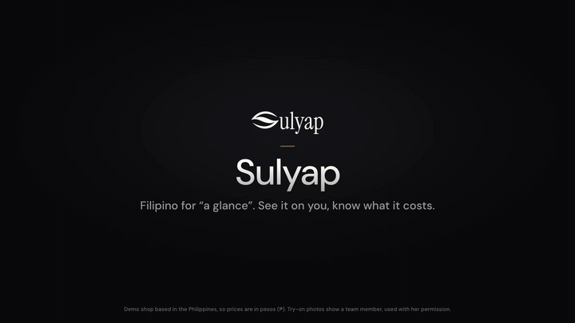

# Sulyap

**See both dresses on you, and the cash each one really needs, before you message the rental shop.**

Sulyap (Tagalog for "a glimpse") is a four-step web app for occasion-dress rentals. You set your dates and cash limit, shortlist two dresses, and preview **both on your own photo with the YouCam AI Clothes API**. Then you copy a clear inquiry for the shop. Built for the [YouCam API Skin AI & eCommerce VTO Hackathon](https://youcam-api-skin-ai-ecommerce.devpost.com/) (eCommerce VTO track).

**Live demo: [sulyap-gilt.vercel.app](https://sulyap-gilt.vercel.app)** (no account needed; the try-on uses real YouCam renders).

**Demo video (1:57): [youtu.be/YgNzSFA-P7Y](https://youtu.be/YgNzSFA-P7Y)** · [Devpost project](https://devpost.com/software/sulyap)



▶ [Watch the 30-second teaser with sound](docs/sulyap-teaser.mp4) · The try-on photos show a team member, used with her permission.

## What it does

1. **Occasion:** collection, event and return dates (up to three inclusive days, Asia/Manila) and the total cash you can bring by collection.
2. **Shortlist:** six fictional occasion dresses with date availability, rental charge, mandatory fee, security deposit and payment stages. Choose two.
3. **Compare:** after consent, add one full-length photo and press **Create my two looks**. YouCam AI Clothes dresses the same photo in each dress. Each preview sits beside its original reference, above a payment table: reservation payment, remaining payment and total cash through collection.
4. **Inquiry:** copy, download or print a text inquiry with the chosen dress, dates, payment breakdown and what the shop must still confirm. It never includes the photo, and it is not a booking or payment.

A preview changes the picture, never the money. All rental, deposit and date rules live in `src/domain/rental.ts` and use integer centavos.

## YouCam integration

| YouCam API | Used for |
| --- | --- |
| [AI Clothes V4](https://docs.perfectcorp.com/reference/ai_clothes/v4.0) `POST/GET /s2s/v2.0/task/cloth-v4` | One try-on task per selected dress (`garment_category: full_body`, `filter_multi_person: normal`) |
| File API `POST /s2s/v2.0/file` + presigned `PUT` | Uploading the shopper's photo once, and each dress reference once (cached) |

```
Browser                          Sulyap server (/api/try-on/*)                 YouCam
consent → photo resized to       POST /photo  → File API slot + PUT        →   file_id
≤1600px JPEG (EXIF dropped)      POST /looks  → reference upload (cached) + cloth-v4 task
                                 GET  /looks?task=…  → task status          →   running | success | error
two cards show results beside the original references; cash table unchanged
```

- **Key safety:** `YOUCAM_API_KEY` is read only by server code (`server/`, `api/`). It has no `VITE_` prefix, never reaches the browser bundle, and is never logged.
- **Consent first:** the photo field is disabled until the shopper agrees. Nothing is uploaded until **Create my two looks** is pressed.
- **No silent duplicate billing:**
  - Results are keyed by photo hash + dress, and moving between steps reuses them.
  - The server reuses a task for the same photo + dress for 30 minutes.
  - **Check again** resumes the same task; only **Try again** after a failure starts a new one.
- **Bounded polling:** first check after 2.5s, then every 3s, for about 2 minutes. Three network failures in a row stop polling and ask.
- **Plain-language errors:** no standing pose, more than one person, lower-body-only photo, out of credits, rate limited, rejected key, or expired task or link. Result links expire after about 2 hours; a broken image asks the same task once for a fresh link.
- **Usage guards:** per server instance, 12 looks per visitor per hour and 150 per day (`TRY_ON_LOOKS_PER_VISITOR_PER_HOUR`, `TRY_ON_LOOKS_PER_DAY`).
- **Privacy:** Sulyap stores nothing, and refreshing clears the photo and looks. Under YouCam's API terms, uploads and results are stored in the United States and deleted automatically after 30 days.

## Project structure

| Path | Contents |
| --- | --- |
| `src/domain/rental.ts` | Money, payment stages, date rules and inquiry text (no UI) |
| `src/data/catalog.ts` | The six fictional dresses |
| `src/app/` | Journey screens and components; `tryOn/` holds the browser API client, photo preparation and `useTryOn` hook |
| `src/app/components/TryOnPanel.tsx` | Consent, photo, action and per-dress status |
| `src/components/ui/` | shadcn/ui primitives |
| `server/youcam.ts` | Typed YouCam client: File API upload, `cloth-v4` create and status |
| `server/tryOn.ts` | Try-on routes: validation, task reuse, rate limits, error vocabulary |
| `server/vitePlugin.ts` | Serves the routes from `npm run dev` and `npm run preview` |
| `api/try-on/` | Vercel Functions using the same handler |
| `tests/` | Playwright browser checks (`*.test.ts` unit tests sit beside their code) |
| `scripts/smoke-try-on.mjs` | One-render live test through Sulyap's own API |
| `public/` | Dress images and logo |

## Run locally

Node 22.12+ and npm.

```sh
npm ci
cp .env.example .env.local   # paste your key after YOUCAM_API_KEY=
npm run dev                  # http://127.0.0.1:5173
```

Without a key the app still works and says personal try-on is not connected.

**Getting a key:**
1. Register for the hackathon on Devpost to receive a redeem code.
2. Sign up at [YouCam API](https://yce.perfectcorp.com/ai-api) and redeem the code under **Account → Redeem Code**.
3. Create a key on the console's **API Keys** page. Use the `sk-…` API key; the separate secret key is not needed.

Prove one real render (uses one task):

```sh
node scripts/smoke-try-on.mjs path/to/full-length-photo.jpg midnight
```

Best photos show one adult, full length, standing and facing the camera, against a plain background in good light, as JPG or PNG.

## Checks

```sh
npm run typecheck
npm run lint
npm test                 # rental rules, comparison output, YouCam client and server (mocked fetch)
npm run build
npx playwright install chromium
npm run test:e2e         # 55 Chromium checks; try-on specs mock /api/try-on, so no units are spent
```

Playwright starts its own dev server with `YOUCAM_API_KEY` blank. It reuses a server already running on port 5173, so stop any server that has a real key first.

## Deploy (Vercel)

The live demo runs on Vercel's free plan. To deploy your own copy:

1. Import the GitHub repository in Vercel (Vite is detected; no root directory setting needed).
2. Add `YOUCAM_API_KEY` under **Settings → Environment Variables**.
3. Deploy, then open `/api/try-on/config`; it should report `"configured":true`.
4. Run one live look against it: `node scripts/smoke-try-on.mjs photo.jpg midnight https://<your-app>.vercel.app`.

`vercel.json` gives the functions 30 seconds and bundles the dress references. If a reference is missing from the bundle, the server fetches it from the site's own static files. If YouCam ever rejects the key on its documented host, set `YOUCAM_API_BASE_URL` (see `.env.example`).

## Verified

- Typecheck, lint and production build pass.
- 12 Vitest checks:
  - Request shapes sent to YouCam.
  - The key never appears in responses or logs.
  - One task per photo + dress, with concurrent duplicates collapsed.
  - Rate limits, and status and error mapping.
  - The payment table is identical with and without a YouCam result.
- 55 Playwright checks, including four try-on journeys at 390px and 1280px:
  - Consent gating, and no upload before the explicit request.
  - One upload and exactly two tasks; results beside originals.
  - Back/forward reuse.
  - Partial failure with a single-dress retry; photo removal; error text.
  - An inquiry free of photo data.
- Live YouCam, 1 November 2026:
  - One `cloth-v4` render completed in 18.3s (1024×1536 result).
  - In the browser, one photo produced both looks in about 20s.
  - Navigating away and back kept 1 upload and 2 tasks.
  - The key was absent from `dist/` and Git.

Not yet measured: unit cost per V4 render.

## Design

Fashion-studio direction: ivory surfaces, charcoal actions and a warm brown accent, with Instrument Serif headings and DM Sans controls (self-hosted). Components are shadcn/ui on Radix with Tailwind 4 tokens in `src/styles.css`. The layout keeps keyboard focus, visible labels, text-based status (never color alone), reduced-motion support and mobile layouts from 320px.

## Data notice

The shop (Amihan Occasion Studio), prices, dates and policies are fictional demonstration data. Catalog photos in `public/images/` are AI-created illustrations and are labeled as such in the app. An AI preview does not confirm size, physical fit or availability, and the app does not book, pay or send messages.

## License

[MIT](LICENSE)
